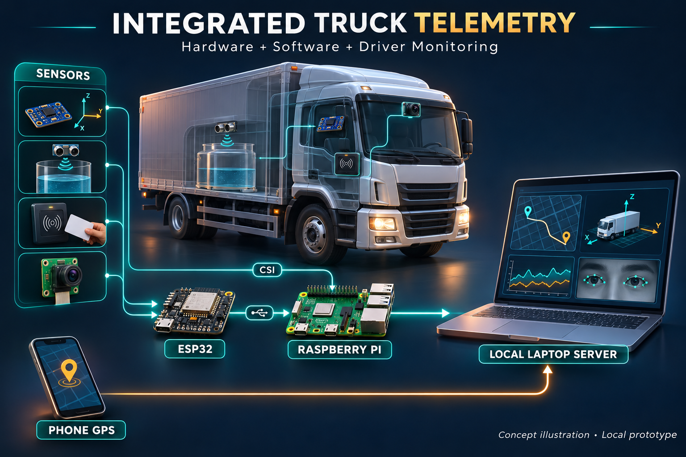
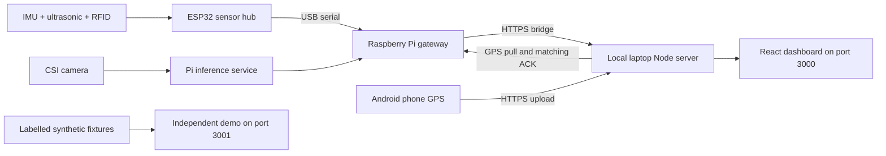

# Integrated Truck Telemetry

**Systems Design semester project · SASTRA Deemed University · Portfolio by Mohammed Nafees H**



*AI-generated concept illustration, not an assembled-product photograph or wiring guide. The actual prototype uses a single ultrasonic probe and an open cuboid water tank; the artwork simplifies the hardware.*

A local engineering prototype bringing phone GPS, inertial orientation, ultrasonic surface distance, RFID card association and camera-derived driver cues into a common dashboard. My main learning was bridging hardware and software through modular interfaces, timestamped observations and careful debugging.

## Public and private editions

This is the **public portfolio/source edition**, with a fresh Git history. The complete working project remains in a separate private repository. This public copy excludes real telemetry, card/device records, account configuration, credentials, student registration numbers, personal recordings, raw dashboard captures and original submission documents. It does not inherit the private repository's history.

The private repository is not a deployment dependency. Configure your own hardware and secrets to use this source. The generic synthetic dashboard can run independently of the Pi. Personal replay clips, APKs and ONNX weights are not bundled here.

## What it does

| Module | Implementation | Boundary |
|---|---|---|
| Position and route context | Android phone GPS, map, geofence geometry | Requires fresh measured fixes; synthetic fixtures are labelled |
| Truck Dynamics | BNO085 attitude and 3D truck orientation | Orientation view, not a calibrated harsh-driving classifier |
| Water/fuel demonstration | SR04M-2 trigger/echo gap measurement | Raw surface distance; volume needs physical calibration |
| Driver association | RC522 UID-to-driver registry | Identifies a card, not a person or ignition permission |
| Driver monitoring | Pi CSI camera, face/landmark inference and temporal rules | Prototype cues, not certified fatigue detection |
| Diagnostics | Separate freshness and validity for each source | A healthy link does not imply a fresh sensor |

## Architecture



The final submission runs on a laptop local server. Public hosting was explored but deferred after hosting/configuration/connectivity difficulties. The current Pi/phone transport can use a temporary HTTPS tunnel; internet is also needed for online map tiles. Local hosting does not mean fully offline operation.

## Source layout

```text
apps/dashboard/                 React interface, local Node backend, tests
apps/android-gps/               Android Java GPS sender source and builder
devices/pi/prototype/           Sensor gateway and camera adapter source
devices/pi/bridge/              Telemetry/JPEG uploads and GPS delivery ACK
third_party/fatigue-engine/     Attributed inference source (weights excluded)
hardware/fuel-calibration/      Approved cuboid tank CAD and source
docs/                          Setup, model explanation and release boundaries
```

## Requirements and estimated hardware cost

| Item | Estimate INR |
|---|---:|
| Raspberry Pi 5, storage and power | 25,000 |
| ESP32 and USB data cable | 500 |
| BNO085 IMU | 2,000 |
| SR04M-2 ultrasonic probe | 500 |
| RC522 RFID reader/card | 250 |
| Camera module and ribbon | 4,000 |
| Wires, protection and mounting | 200 |
| Printed demonstration tank | 450 |
| **Total estimated purchases** | **32,900** |

Existing phone and laptop are not counted as new purchases. Software: Node.js 22.12+ (24 LTS used by setup), Python 3.11+, Raspberry Pi OS camera support, Arduino tooling for ESP32, and Android tools if rebuilding the app. These are project estimates, not invoices.

## Start the public demo

```sh
git clone https://github.com/mohammednafees1007-hub/integrated-truck-telemetry-public.git
cd integrated-truck-telemetry-public/apps/dashboard
npm ci
node scripts/secrets.cjs
npm run build
npm run build:synthetic
```

The secret generator writes local `.env` and `.private/ACCESS.md`; keep both private. See [setup](docs/SETUP.md) for the real receiver, the independent demo process and Pi configuration. Do not run the commissioned laptop's old automation against an unconfigured new Pi.

## Dashboard operation

Dashboard gives the integrated overview; Fleet Management inspects the prototype; Drivers maintains your own card registry; Geofencing configures geometry; Driver Monitoring shows camera/result validity; Truck Dynamics displays valid IMU orientation; Fuel Analysis shows distance trends and a manual refuel ledger; Notifications reviews events; Advanced Settings exposes source freshness and pairing. Missing readings remain unavailable. Synthetic demonstration values must not be presented as live hardware readings.

## Driver-monitoring model

CSI frame → face detector → 98 landmarks → eye/mouth geometry and approximate head cues → temporal counters → rule-based severity → result JSON. Existing ONNX weights are integrated, not trained by this project. EAR/MAR and counters support the cues; measured PERCLOS and validated population accuracy are not established. A preview image and a valid inference have independent freshness. [Model details](docs/DRIVER_MONITORING.md).

## Water tank

Internal cavity: 100 × 80 × 70 mm. A 500 mL water limit corresponds to 62.5 mm depth. The removable split holder uses a 23.22 mm measured probe outer ring, nominal 23.10 mm bore, with its lower face 30 mm above the rim. Fit, leakage, acoustic reference and blind-zone range require physical verification. [3MF and CAD source](hardware/fuel-calibration/).

## Results and limitations

Historical bench observations recorded gateway/bridge/probe rates of 49.951 / 8.820 / 9.997 Hz over 12.132 s. One phone screen-off test recorded 135 sequence advances over 135.243 s. A matching GPS acknowledgement was observed 0.698 s after laptop receipt using one clock. These are dated bench observations, not current connectivity, positioning accuracy or field-performance guarantees.

Intermittent IMU initialization, fuel calibration, a mounted road trial, and quantified fatigue evaluation remain limitations. Tyre monitoring, battery protection, ignition control, predictive maintenance and dependable public hosting are outside the final scope.

## Checks

```sh
# apps/dashboard
npm test
npm run lint
npm run build
npm run build:synthetic
# devices/pi/bridge
python -m unittest -v test_bridge
```

Software checks do not prove physical readiness. This export is a source reference, not a precommissioned appliance.

## Learning and contact

This semester strengthened my understanding of modular system design, hardware/software integration, networking and hosting choices, debugging, timestamped sensor processing, model mathematics, Android application integration and CAD. It was a practical bridge between earlier hardware projects and software development.

For project discussion or access to additional non-public material, contact [Mohammed Nafees H on LinkedIn](https://www.linkedin.com/in/mohammed-nafees-h/) or visit [my GitHub profile](https://github.com/mohammednafees1007-hub).

Read [attribution and reuse](THIRD_PARTY_NOTICES.md) before reusing source or models. The original source provenance is retained; public visibility is not a blanket licence for all upstream assets.
