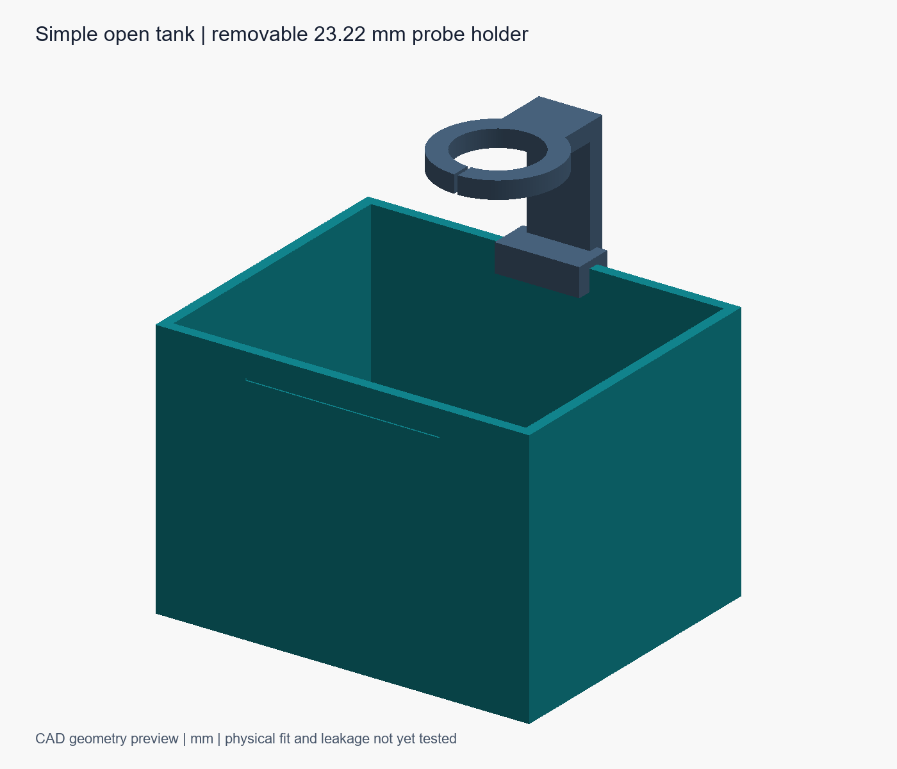

# Approved cuboid water-demo tank

This is the current approved **simple open-top cuboid tank** for showing the ultrasonic water-level demonstration. It replaces the earlier tall two-piece mast design.

## Print files

- [Download the 3MF](Fuel_Calibration_Tank_A1.3mf): tank, removable holder and optional fit-test ring arranged within one A1 bed. This is an unsliced geometry file; select material and print settings in the slicer.
- [Tank STL](print/Open_Tank_500mL_MAX.stl)
- [Probe-holder STL](print/23.22mm_Probe_Clip_Holder.stl)
- [Optional press-fit test STL](print/Optional_Pressfit_Test.stl)
- [Parametric CAD source](build_simple_tank.py) and [digital checks](validation.json)

## Dimensions and demonstration

| Item | Dimension |
|---|---|
| Internal box | 100 × 80 × 70 mm |
| External box | 106 × 86 × 74 mm |
| Walls / floor | 3 mm / 4 mm |
| Working fill limit | **500 mL MAX** at the exterior horizontal groove |
| Water depth at 500 mL | 62.5 mm above the inside floor |
| Headroom above MAX | 7.5 mm (geometric brim volume is 560 mL) |
| User-measured probe outer ring | **23.22 mm**, single probe |
| Split press-fit bore | 23.10 mm, nominal 0.12 mm diametral interference |
| Holder lower face above rim | 30 mm |
| Holder lower face above MAX water | 37.5 mm |

Slide the holder's U clip onto the rear rim. The short clip stays above the MAX water volume. Press the single probe into the circular split ring only after checking the optional fit-test ring. The top remains open for filling and pouring out water. Add measured water increments and compare sensor readings with the actual level; this file does not change the dashboard calibration.

The stated clearance is to the holder plane. The acoustic face-to-water distance depends on probe insertion depth. **This compact arrangement may be inside the probe's minimum measuring distance; readings and wall echoes require a physical test.** No real calibration performance is claimed.

## Printing and verification

All three meshes are closed, consistently wound, positive-volume single solids and fit the nominal 256 mm A1 envelope. The tank/holder do not intersect and neither intrudes into the nominal 500 mL water volume. Physical press-fit, leakage and sensor operation are untested.

Print the optional fit ring first. Never force the probe into an overly tight ring; printer/material tolerances may require bore adjustment. Tank prints upright; holder is oriented on its rear face, with any clip overhang support to be inspected in the slicer. Starting settings: 0.2 mm layers and 5–6 walls, adjusted for material. Leak-test with water over a tray away from electronics. Use water only, not automotive fuel.

The earlier mast design remains recoverable through Git history; this is the design to use for the cuboid tank demonstration and report illustration.
